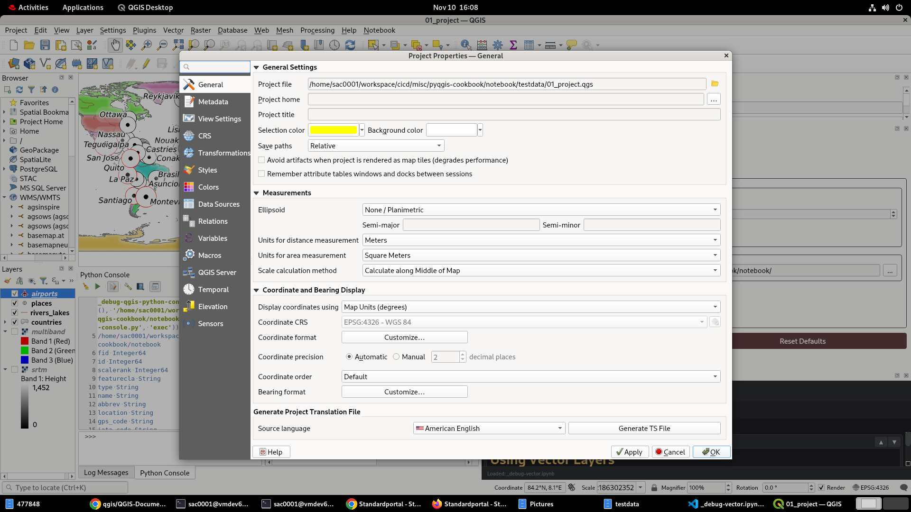
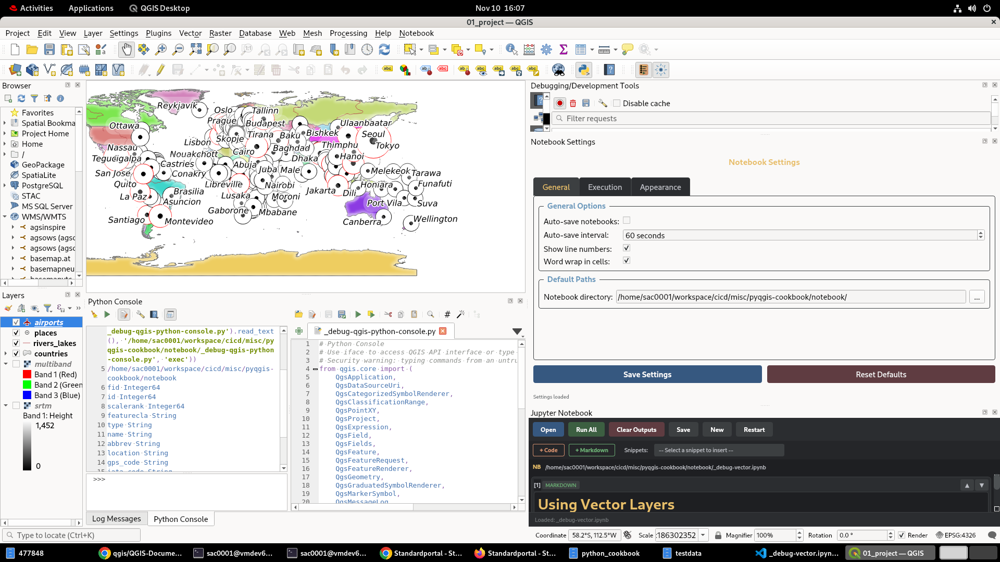
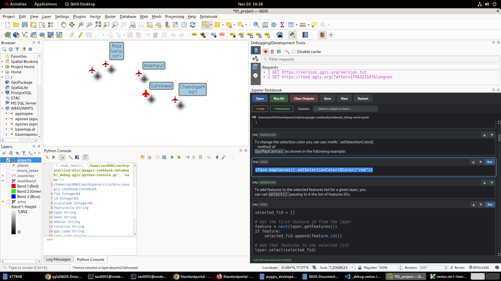

https://github.com/qgis/QGIS-Documentation/tree/master

## Step 1
* Contents of: ./QGIS-Documentation_qgis-projects/python_cookbook/
* have been moved to: ./notebook/testdata/

## Step 2

## Step 3
* select airports layer
* zoom in, till airport features become visible/active
* run notebook to #10 (select all) or #16 (select fid)
* airports layer > context-menu > zoom to selected

---

# pyqgis-cookbook

PyQGIS cookbook in markdown and Jupyter notebook formats

This repository contains the PyQGIS cookbook in markdown and Jupyter notebook formats. They are generated from the RST source files in the `rst` directory, which are copied from the [QGIS documentation repository](https://github.com/qgis/QGIS-Documentation/tree/master/docs/pyqgis_developer_cookbook). Credits to the QGIS documentation team for the original content.

